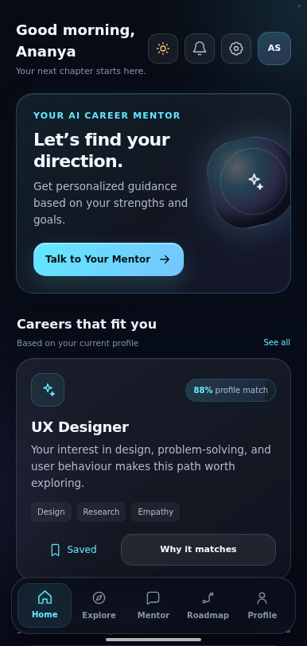
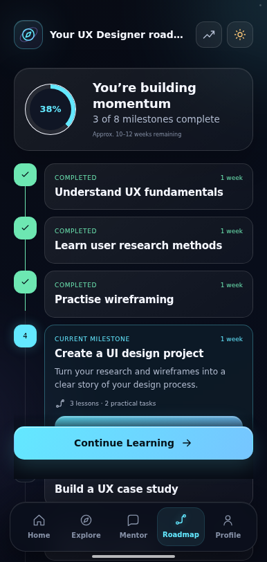
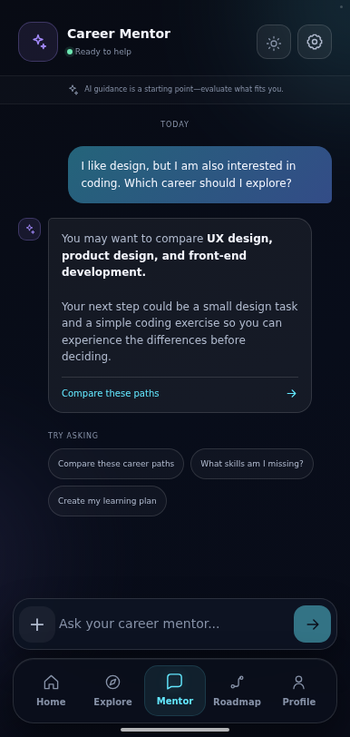
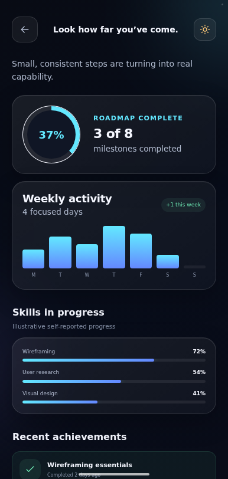

# AI Career Mentor App

A mobile-first React prototype of an AI career-guidance app for students, graduates and career changers. It helps people discover personalised career paths, understand their skill gaps and follow practical roadmaps with AI mentor guidance.

**Live demo:** https://rr188351.github.io/AI-Career-Mentor-App/

<div align="center">
  
  
  
  
</div>

## Highlights

- **19-screen journey** — splash, welcome, login, signup, stage, interests, goals, assessment, results, home, explore, career details, compare, AI mentor, roadmap, progress, notifications, profile and settings.
- **No backend required** — theme, saved careers, skills, profile and notification preferences persist in `localStorage`.
- **Dark and light themes** driven entirely by CSS custom properties.
- **Real iPhone 14 frame on desktop** — bezel, Dynamic Island, side buttons and a glass sheen; on phones the frame disappears and the app fills the screen.
- **Minimal dependencies** — React and React DOM only at runtime.

## Tech stack

| Area | Choice |
| --- | --- |
| UI | React 19 + TypeScript 5.7 |
| Build | Vite 8 |
| Styling | Tailwind CSS v4 utilities plus hand-authored design tokens in `src/index.css` |
| Formatting | oxfmt |

## Getting started

```bash
npm install
npm run dev      # dev server on http://localhost:8443
npm run build    # production build into dist/
npm run preview  # serve the production build
npm run format   # format with oxfmt
```

The project also ships a `pnpm-lock.yaml`, so `pnpm install` works too.

### Preview a single screen

The app accepts a `?screen=` query parameter, which is handy for screenshots and portfolio maintenance. It does not add routing or change the normal user journey:

```text
/?screen=home
/?screen=roadmap
/?screen=settings
```

## Desktop preview frame

On viewports **640 px or wider** the app is rendered inside the app's own iPhone 14 mockup. The phone is a fixed `426 × 908` device that is scaled uniformly (`transform: scale(var(--ps))`) inside a footprint wrapper, so it keeps exact phone proportions at any window size instead of stretching. Height bands pick `--ps` so the phone always fits the window.

Everything lives in the "iPhone 14 device frame" block at the end of `src/index.css`:

- `.device` — the body (padding `44px 17px 17px`, radius `54px`)
- `.device-island` — the Dynamic Island, housed inside the top bezel so it never covers the UI
- `.device-button` — volume and power buttons
- `@media (min-width: 640px) and (max-height: …)` — the `--ps` scale bands

## Deployment (GitHub Pages)

`.github/workflows/deploy.yml` builds the app on every push to `main` and publishes it with GitHub Pages.

One-time setup in the repository: open **[Settings → Pages](https://github.com/rr188351/AI-Career-Mentor-App/settings/pages)** and set **Build and deployment → Source** to **GitHub Actions**. Until that is done, the workflow stops at its "Configure Pages" step, and GitHub's built-in *pages-build-deployment* (branch source) publishes the raw repository instead of the built app.

What the workflow does:

1. `npm ci`
2. `npm run build` with `GITHUB_PAGES=true`, which switches Vite's `base` to `/AI-Career-Mentor-App/`
3. copies `case-study/` into `dist/case-study/` so the UX portfolio is published too
4. uploads `dist/` and deploys it

Resulting URLs:

- App — `https://rr188351.github.io/AI-Career-Mentor-App/`
- UX case study — `https://rr188351.github.io/AI-Career-Mentor-App/case-study/`

To build the Pages variant locally, or to override the base path (for a custom domain or a `<user>.github.io` site):

```bash
GITHUB_PAGES=true npm run build          # /AI-Career-Mentor-App/
GITHUB_PAGES=true VITE_BASE_PATH=/ npm run build
```

## Project structure

```text
.
├── .github/workflows/deploy.yml   # GitHub Pages build + deploy
├── .figma/make/                   # Figma Make tooling (dev server, deploy, site config)
├── case-study/                    # standalone UX/UI portfolio site
├── public/favicon.svg
├── src/
│   ├── App.tsx                    # screens, components and app state
│   ├── index.css                  # design tokens, component styles, iPhone 14 frame
│   └── main.tsx
├── index.html
├── vite.config.ts
└── package.json
```

`.figma/make/site.json` holds the site metadata (title, description, robots). `index.html` keeps `figma:*` comment slots that the Vite plugin fills from that file at build time.

## UX case study

`case-study/` is a standalone static site (semantic HTML, CSS and JavaScript) documenting the design process. Open `case-study/index.html` directly, or serve the directory with any static file server — all asset URLs are relative. It is also published at `/case-study/` by the workflow above.

The screenshots in `case-study/assets/screenshots/` were captured from the production build at `386 × 812`. They are stored as regular files — this repository deliberately does not use Git LFS, so keep new assets small.

## Accessibility

The app includes semantic landmarks, labelled controls, visible focus states, `prefers-reduced-motion` support and an accessible theme switch. The case study adds skip navigation, a keyboard-operable screenshot selector, a lightbox and reduced-motion support.

## Verification

```bash
npm run build      # Vite production build
npx tsc --noEmit   # type check
```
